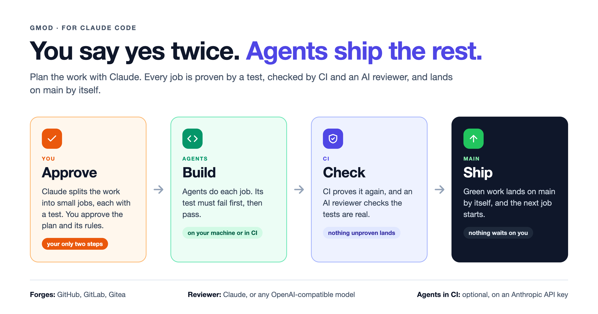

# gmod

**You say yes twice. Agents ship the rest.**

Plan your work with Claude. Agents build it, prove it works, and land it on `main`, working beside you or on their own in CI.



## Install

In Claude Code:

```
/plugin marketplace add soundheart-studios/gmod
/plugin install gmod@gmod
```

Once per machine. From then on gmod is there in every project you open, and quiet in projects without a plan.

## Ship your first job

Open Claude Code in your project and say what you want:

```
/gmod:plan  a blog with tags and reading time
```

Claude drafts the plan and you approve it. Then connect your CI:

```
/gmod:ci
```

That's it. Every job lands by itself once it's proven. Do the work with Claude (`/gmod:work`), or let agents in CI take each job as the one before it lands.

## What CI does

| | What it does | Model | On? |
|---|---|---|---|
| **1. Gate** | Proves every pull request again: the job's test fails without the change and passes with it, the change stays in the job's files, and `main` stays protected. Green work lands by itself. | none, plain code | always |
| **2. Review** | An AI reads the change: are the tests real, is anything weakened? It judges; it never writes code. | Claude, or any OpenAI-compatible model (DeepSeek, one you host) | your choice |
| **3. Agents** | Claude Code picks up ready jobs, writes and proves the code, and opens the pull request. It also fixes its own failed checks and does what you ask with `@gmod`. | Claude, on an Anthropic API key | off unless you turn it on |

Nothing lands without passing the gate, whoever wrote it, you or an agent. Agents' pull requests get the same gate and review as yours.

| You want | Run |
|---|---|
| Gate and review; you build on your machine | `gmod setup` (Claude reviews), or `gmod setup --reviewer-url <url> --reviewer-model <model>` |
| Gate only | `gmod setup --reviewer none` |
| All of it, agents included | `gmod setup --agents 1`, with an Anthropic API key as the `GMOD_AGENT_KEY` secret |

Agents in CI always use an API key, never a person's Claude sign-in. More: [setting up a repository](docs/setup.md#what-ci-does).

## Why gmod

- **Proof, not promises.** Every job's test fails before the change and passes after. CI proves it again, and an AI reviews it.
- **Nothing waits on you.** Work lands on green. You only approve the plan and the rules.
- **Works with what you have.** GitHub, GitLab or Gitea. Claude, DeepSeek, or a model you host.

## Learn more

- [How it works](docs/how-it-works.md)
- [Agents, on your machine and in CI](docs/agents.md)
- [Setting up a repository](docs/setup.md)
- [Day to day](docs/day-to-day.md)
- [Commands](docs/commands.md)
- [Limits, honestly](docs/limits.md)
- [Reference: how it works inside](docs/reference.md)
- [Notes for later](docs/notes/)

## License

MIT, © 2026 Soundheart Studios. See [LICENSE](LICENSE).
