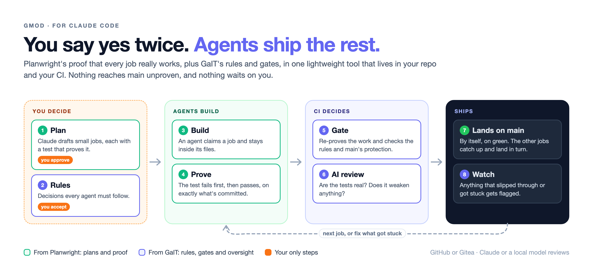

# gmod

**You say yes twice. Agents ship the rest.**

Plan your work with Claude. Agents build it, prove it works, and land it on `main`, working beside you or on their own in CI.



## Install

In Claude Code:

```
/plugin marketplace add soundheart-studios/gmod
/plugin install gmod@gmod
```

Once per machine. From then on gmod is there in every project you open, and quiet in projects without a plan.

## Ship your first job

Open Claude Code in your project and say what you want:

```
/gmod:plan  a blog with tags and reading time
```

Claude drafts the plan and you approve it. Then connect your CI:

```
/gmod:ci
```

That's it. Every job lands by itself once it's proven. Do the work with Claude (`/gmod:work`), or let agents in CI take each job as the one before it lands.

## Why gmod

- **Proof, not promises.** Every job's test fails before the change and passes after. CI proves it again, and an AI reviews it.
- **Nothing waits on you.** Work lands on green. You only approve the plan and the rules.
- **Works with what you have.** GitHub, GitLab or Gitea. Claude, DeepSeek, or a model you host.

## Learn more

- [How it works](docs/how-it-works.md)
- [Agents, on your machine and in CI](docs/agents.md)
- [Setting up a repository](docs/setup.md)
- [Day to day](docs/day-to-day.md)
- [Commands](docs/commands.md)
- [Limits, honestly](docs/limits.md)
- [Reference: how it works inside](docs/reference.md)
- [Notes for later](docs/notes/)
