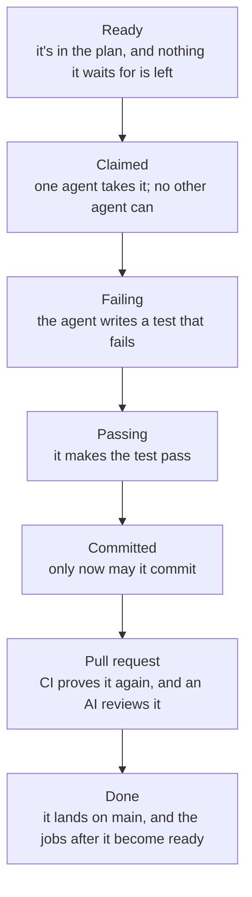

# How gmod works

- **A plan** is a list of small **jobs**. Each says what it achieves, which files it may touch, and the check that proves it's done.
- **Rules** (architecture decision records) bind every job they cover. The AI review holds each pull request to them.
- **Every job proves itself:** its check fails before the change and passes after. CI proves it again on its own, an AI reviewer reads it, and then it merges on green.
- **You only approve.** Plans and rules are yours. Everything after is agents and CI.

## A job's life



## One rulebook, three enforcers

Every rule lives in the `gmod` CLI. The plugin calls it while agents work, you can call it from a terminal, and CI calls it on every pull request, so an agent hears exactly what CI will say later.

| Where | What it stops |
|---|---|
| **While an agent works** (the plugin) | edits outside the job's files; commits without red then green; agents writing the plan or rules, approving, or merging by hand |
| **Before it merges** (CI + protection) | jobs not in `main`'s plan or not claimed; files outside the job; tests that pass without the change; plan, rule or CI changes mixed with code; anything that weakens what is checked; a protection weaker than `.gmod/protect.json` |
| **After it lands** (CI) | anything that reached `main` without what it requires (a breach issue); jobs that stall (a stuck issue) |

## Everything is git

The plan, rules and journals are files. A claim is a tiny ref, `refs/gmod/claims/<job>`, and pushing it is the lock: the first push wins. A job is done when a commit starting `<job>:` is on `main`. Red and green runs stay on your machine; CI proves the work again anyway.

## Proof, not trust

CI takes the job's tests from the branch, puts the old code back, and checks they fail; then checks they pass on the new code. A test that never failed proves nothing.

## What's in your repository

```
.gmod/plan.json        the plan: phases, jobs, their files and checks
docs/adr/              the rules you accepted
.gmod/protect.json     what main requires: {"require": ["gate", "review"]}
.gmod/journal/         each job's notes, read by the reviewer
.github/workflows/gmod.yml   (or .gitlab-ci.yml, or .gitea/workflows/gmod.yml)
```
