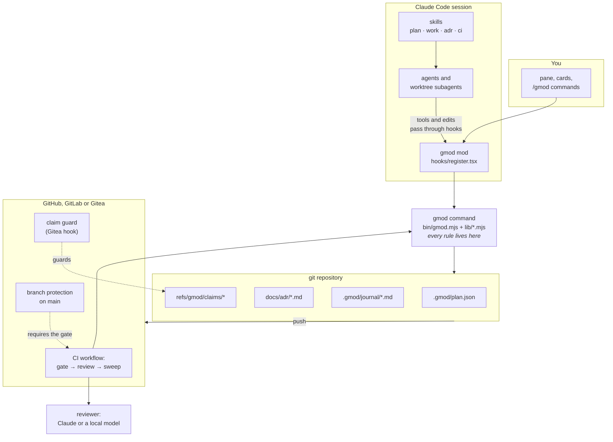
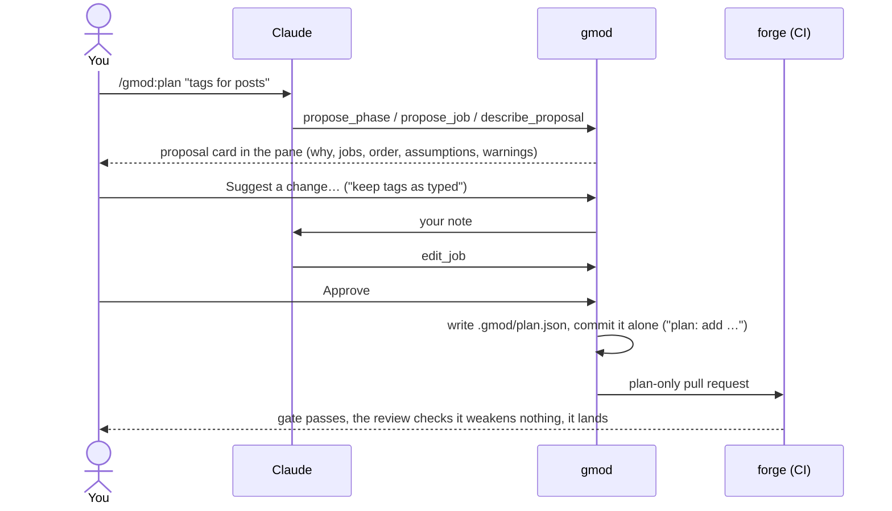
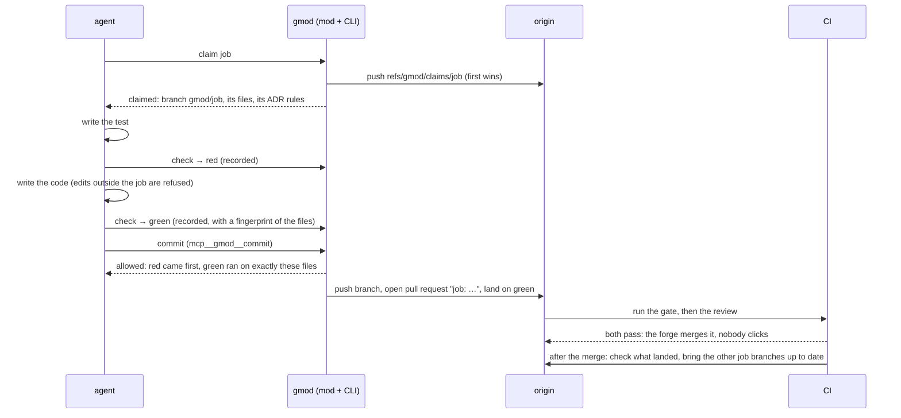
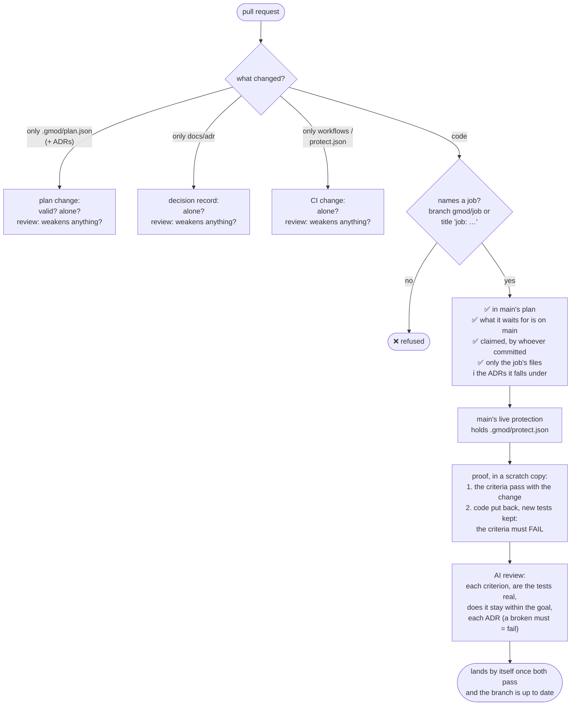
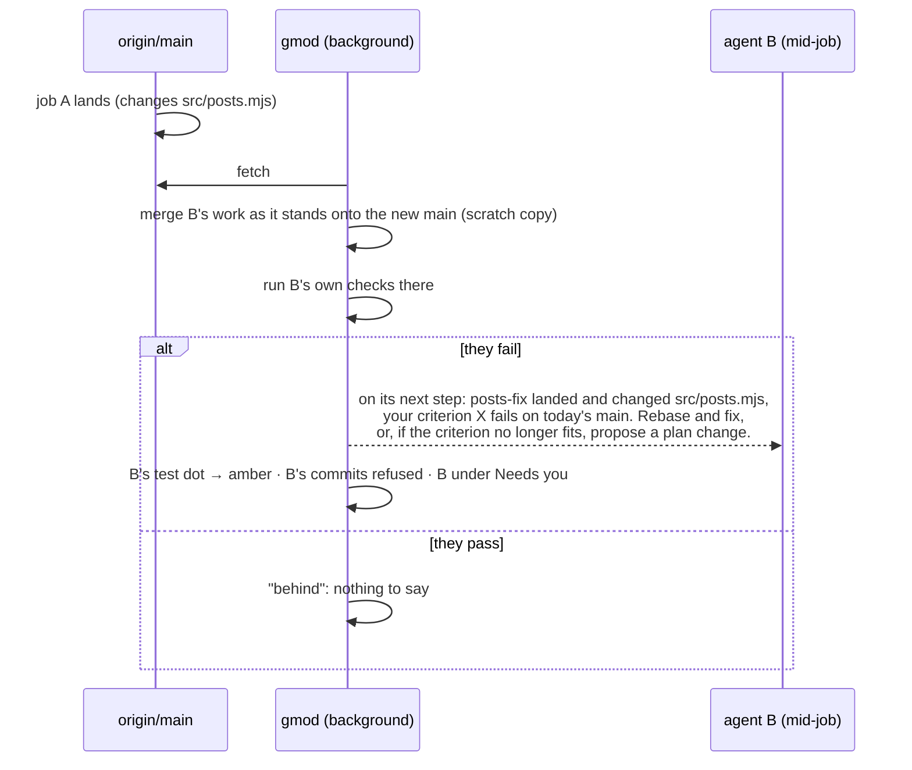
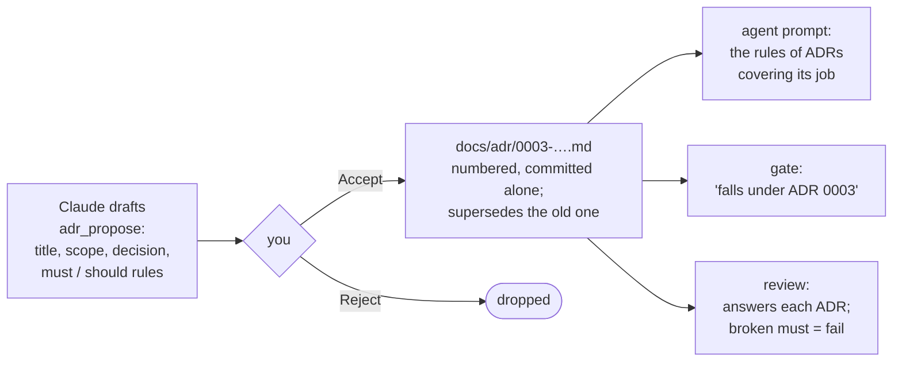

# Reference: how gmod works inside

The deep version, for when you want to know exactly what happens. Start with [how it works](how-it-works.md) for the short one; setting up CI is in [setup](setup.md).

## The parts



**One rulebook, three enforcers.** Every rule is in the `gmod` command (`lib/core.mjs`, `lib/adr.mjs`, `lib/ci.mjs`, `lib/receive.mjs`). The mod, a person at a terminal and CI all call the same code, so an agent hears exactly what CI will say later.

## Where the state lives

There's no database: everything is in git, or in git's own folder on your machine.

| What | Where | Shared? |
|---|---|---|
| The plan: phases, jobs, checks, contracts | `.gmod/plan.json` | yes, committed |
| Decisions | `docs/adr/NNNN-*.md` | yes, committed |
| Each job's journal | `.gmod/journal/<job>.md` | yes, committed with the job |
| Claims ("this job is mine") | `refs/gmod/claims/<job>` on origin | yes; the first push wins |
| "Done" | a commit on `main` whose subject starts `<job>:` | yes |
| Plan and ADR drafts | `.git/gmod/proposal.json`, `adr-drafts.json` | no, local until approved |
| Red/green runs, the claim in this worktree | `.git/gmod/` (each worktree has its own) | no; CI re-checks anyway |

A claim is a tiny git ref. Pushing it is the lock: if someone else pushed it first, your push is refused.

## What gets refused, and where

```mermaid
flowchart LR
    subgraph edit["While the agent works (mod)"]
        E1["edit outside the job's files"]
        E2["commit without red, then green"]
        E3["write the plan, ADRs or gmod's records"]
        E4["move a claim, or approve anything"]
    end
    subgraph push["When it's pushed (Gitea hook)"]
        P1["move a claim"]
        P2["let go of someone else's claim"]
    end
    subgraph merge["Before it merges (CI + protection)"]
        M1["job not in main's plan, or not claimed"]
        M2["commits not by the claimant"]
        M3["files outside the job"]
        M4["tests don't fail without the change"]
        M5["branch behind main"]
        M6["plan, ADR or CI changes mixed with code"]
    end
    edit --> push --> merge
```



Each layer catches different things:
- **The mod** gives immediate, worded feedback to Claude's agents and their subagents. Edits are judged by the repository the file is actually in.
- **The hook** covers anyone pushing, Claude or not, for the one kind of ref branch protection can't see.
- **CI plus branch protection** is final. Nothing reaches `main` without it, whoever wrote the code.

## Planning and approving



- **Drafts can be unfinished while Claude builds them,** for example a phase with no jobs yet. The card then says "not ready to approve" and hides **Approve**.
- **gmod works out warnings itself:** two jobs that change the same files can't run side by side, and a job with no tests can't be proven.
- **Phases group jobs under an outcome.** "Phase B after phase A" means every job in B waits for every job in A. A phase is done when all its jobs are on `main`.

## Doing a job



Agents finish a job with **`mcp__gmod__commit`** (`gmod commit`): it commits exactly what the last passing check ran on, pushes, and opens the pull request with auto-merge on. No raw `git commit`, so nothing for a shell guard to mistake, and a subagent finishes its own job in its own worktree. A `git commit` typed by hand still goes through the same check, in the shell that runs it, judged against the worktree it commits (`git -C <worktree>` included).

If anything is denied, agents are told to say so and stop: never another file, another session or another agent to get round it.

## The CI gate

`gmod verify` runs on every pull request. The job is read from the **base** branch's plan, so a pull request can't widen its own job.



Step 2 of the proof is what makes a test count. A test that passes whether or not the change is there proves nothing, and is refused.

The **AI review** gets a fixed checklist and a strict JSON answer shape. It reads the job's journal as the agent's account of its intent, never as proof. Everything in the pull request is treated as material under review, never as instructions to the reviewer. A change to the governance itself (plan, ADRs, CI, `protect.json`) gets one question instead: does it weaken what is checked? Advice only by default; `--blocking` makes a "fail" stop the merge, and then it **fails closed**: no answer, a malformed one, or an empty diff stops the merge too. A maintainer overrides a fail with the `gmod-override` label.

Both compare against the pull request's **own base commit**, not live `main`: a review that started after the merge once saw an empty diff and judged nothing.

## Landing without a person

What `main` requires is **declared in the repository**, in `.gmod/protect.json`:

```json
{ "require": ["gate", "review"], "up_to_date": true }
```

- `gmod ci protect` applies it, requiring the checks **by exact name** (`gmod / gate (pull_request)`). A pattern like `gmod / gate*` also matches the skipped `(push)` statuses Gitea posts on branch commits, and a skipped status passes: that once let a failing pull request merge before its gate ran.
- The gate refuses every pull request while `main`'s live protection is weaker than the declaration. Loosening it by hand stops all merging until it's put back.
- After each merge, CI checks what landed passed what was required, and opens a **`gmod breach`** issue if not (or if something reached `main` without a pull request).
- After each merge, CI brings every other open job branch up to date, so its checks run again on what it would really land on, and it lands in turn.

Reading protection and updating branches so their checks start need a person's token (CI's own can't read protection, and the forge starts no checks for what CI's token pushes). `gmod ci forge-token` keeps yours as the `GMOD_FORGE_TOKEN` secret.

## When `main` moves under a job

With several agents, one landing can break another's work in progress. gmod checks every two minutes:



| Level | Means |
|---|---|
| fresh | `main` hasn't moved since the job started |
| behind | it moved, and nothing this job depends on changed |
| touched | what landed changed this job's files, or a declared **contract** (`"contracts": ["db/migrations/**"]`) |
| conflicts | the job's work won't merge onto `main` |
| breaks | it merges, but the job's own checks fail on today's `main` |

Because gmod runs the job's **own checks**, it also catches dependencies nobody declared, as long as the job's tests exercise them. Results are cached per `main` commit and per state of the work, so each landing costs one check run per affected job.

## Decisions (ADRs)



Each ADR has a **scope**, the globs of the files it governs, so it only binds the work it's about. Agents can't edit ADR files; decisions change only through a new draft that supersedes the old one.

## The journal

Each job keeps `.gmod/journal/<job>.md`. The agent writes notes there (intent, decisions, dead ends), and every check adds its red or green. It's committed with the job's pull request, so the reviewer and anyone reading `main` later can see why things were done.

---

## Commands, tools and the plan format

### Slash commands and agent tools

| For you | |
|---|---|
| `/gmod` | the pane |
| `/gmod approve` · `reject [why]` | the plan proposal (you only) |
| `/gmod adr accept <draft>` · `adr reject <draft>` | decision drafts (you only) |
| `/gmod next` · `claim <job>` · `check` · `release` · `proposal` · `sweep` | as the CLI |
| `/gmod allow-plan` · `lock-plan` | let the agent edit the plan file directly, for bulk edits |
| `/gmod:plan` · `/gmod:work` · `/gmod:adr` · `/gmod:ci` | the skills |

| For agents (`mcp__gmod__…`) | |
|---|---|
| `next` · `claim` · `check` · `release` · `status` · `note` | doing work; each takes `dir` for a worktree of its own |
| `commit` · `pr_status` | finishing it: commit, push, open the pull request to land on green; how its checks went |
| `propose_phase` · `edit_phase` · `drop_phase` | drafting phases |
| `propose_job` · `edit_job` · `drop_job` · `describe_proposal` | drafting jobs |
| `adr_propose` | drafting a decision |

### The command line

`node ~/gmod/bin/gmod.mjs <command>`, or `gmod` after `npm link` in this folder. Add `--json` for machine-readable output. The exit status is 0 for yes/done and 1 for refused.

| Area | Commands |
|---|---|
| Plan | `init` · `plan` · `next` · `proposal` · `propose-phase` · `edit-phase` · `drop-phase` · `propose-job` · `edit-job` · `drop-job` · `describe-proposal` · `approve` · `reject` |
| Work | `claim` · `release` · `check` · `note` · `commit` · `pr [--auto] [--status]` · `gate-commit` · `guard-path` · `status` |
| Main moved | `moved [--run]` · `notice <path>` |
| Decisions | `adr propose` · `adr drafts` · `adr accept` · `adr reject` · `adr list` · `adr for <path>` |
| Setup | `setup` · `doctor` · `ci upgrade` · `runner up` (Gitea) · `ci secret` |
| CI | `verify` · `prove` · `sweep` · `ci init` · `ci protect` · `ci check` · `ci forge-token` · `ci guard-claims` · `receive` |

### A plan

```json
{
  "main": "main",
  "adr_dir": "docs/adr",
  "contracts": ["db/migrations/**"],
  "checks": { "slug": "node test/slug.test.mjs" },
  "phases": [
    { "id": "post-basics", "title": "Post basics", "outcome": "Every post has its own URL slug" }
  ],
  "jobs": [
    {
      "id": "slugify",
      "phase": "post-basics",
      "goal": "Turn a title into a URL slug",
      "brief": "src/slug.mjs; lowercase, dashes, no punctuation.",
      "files": ["src/slug.mjs"],
      "tests": ["test/slug.test.mjs"],
      "done_when": [{ "text": "\"Hello, World!\" becomes \"hello-world\"", "check": "slug" }],
      "after": []
    }
  ]
}
```

`files` is what the job may change, and `tests` is where its tests go. They're kept apart so CI can put the code back while keeping the tests. A check is a shell command that exits 0 when its criterion holds.

---


## Development

```sh
npm test                                   # CLI, CI and claim-guard tests, against real git repositories
claude plugin test ~/gmod                  # the mod's hooks and pane
GMOD_REVIEW_URL=http://host:8080/v1 \
  node --test test/review-live.test.mjs    # the reviewer against a real model (opt-in)
```

The pane must draw on every Claude Code surface, including the desktop app, which may run an older engine. Run the mod tests with that engine too.
