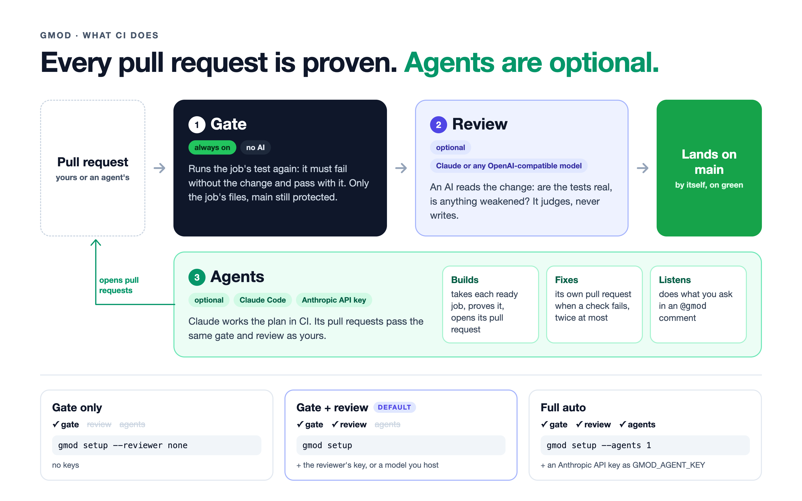

# Setting up a repository

You need Claude Code, `node` 20+, `git`, and your forge's CLI, signed in: `gh` (GitHub), `glab` (GitLab) or `tea` (Gitea). gmod never asks for a token of its own: it uses that login.

In Claude Code, in the repository, run `/gmod:ci`. Claude runs `gmod setup` for you. From a terminal it's the same command (`node <gmod>/bin/gmod.mjs setup`, or `gmod setup` after `npm link` in gmod's folder):

```
$ gmod setup --reviewer-url https://api.deepseek.com/v1 --reviewer-model deepseek-flash
✓ main protected: merge requests only, merged once their pipeline (gate and review) passes, up to date with main
✓ hourly look at what isn't landing scheduled
✓ governance merge request: https://gitlab.com/acme/app/-/merge_requests/1 (.gitlab-ci.yml)
✓ it landed by itself in 123s: gate, review and landing work
```

It protects `main`, writes the CI file and `.gmod/protect.json`, and lands them as one pull request. That pull request landing by itself is the proof the whole loop works. If something it needs is missing (a CI secret, a login), it stops before opening anything and says the exact command that fixes it.

| Flag | Means |
|---|---|
| `--reviewer-url <u> --reviewer-model <m>` | any OpenAI-compatible reviewer; leave out for Claude, `--reviewer none` for no review |
| `--advice` | the review only comments; the gate alone decides |
| `--setup '<cmd>'` | install the project's dependencies before checks run, e.g. `npm ci` |
| `--agents <n>` | agents in CI take ready jobs, at most `n` at once; needs the `GMOD_AGENT_KEY` secret ([agents](agents.md)) |
| `--app` | GitHub: work as the gmod App ([below](#a-github-app)) |
| `--runs-on <label>` | Gitea: which runner takes the jobs |
| `--ref <vX>` | pin another gmod release |

Afterwards, `gmod doctor` checks everything is still in place (each ✗ comes with its fix), and `gmod ci upgrade` opens a pull request that moves the pinned gmod to the newest release.

## What CI does



| | What it does | Model | On? |
|---|---|---|---|
| **1. Gate** | Proves every pull request again: the job's test fails without the change and passes with it, only the job's files changed, the commits are by whoever claimed the job, and `main` is still protected. Green work lands by itself. | none, plain code | always |
| **2. Review** | An AI reads the change: are the tests real, is anything weakened? It judges; it never writes code. | Claude (`ANTHROPIC_API_KEY`), any OpenAI-compatible model (`--reviewer-url`, `--reviewer-model`, key as `GMOD_REVIEW_KEY`), or one on your runner (no key) | unless `--reviewer none` |
| **3. Agents** | Claude Code, headless, picks up ready jobs, writes and proves the code, and opens the pull request; fixes its own failed checks; does what a maintainer asks with `@gmod`. | Claude, on an Anthropic API key (`GMOD_AGENT_KEY`, from console.anthropic.com, billed per use) | only with `--agents <n>` |

Nothing lands without passing the gate, whoever wrote it. Agents' pull requests get the same gate and review as a person's. Without agents, the work happens on your machine with `/gmod:work`, on your own Claude login.

Claude sign-in tokens (`claude setup-token`, `sk-ant-oat…`) are never used in CI: `gmod ci secret` won't store one as `GMOD_AGENT_KEY`, and the action and GitLab jobs run no agents on one.

How you control agents in CI:

- **How many:** `agents: <n>` in the CI file, at most that many at once. `0`, or no `agent-key`, turns them off; so does deleting the `GMOD_AGENT_KEY` secret.
- **What they may do:** only ready jobs of the plan you approved, only in each job's files, and only with red-then-green proof. Their pull requests go through the same gate and review as yours.
- **When they stop:** two tries to fix failed checks, then a **gmod stuck** issue; no agent takes that job until you close it.
- **Looking first:** the `gmod-hold` label keeps an agent's pull request open, checked but not landed, until you take it off. `@gmod <request>` on it, from someone who can write to the repository, has an agent make the change (GitHub and Gitea).

## A GitHub App

By default gmod acts with CI's own token on GitHub. That works, but GitHub then leaves empty, red runs behind the pull requests agents open ([why](notes/ci-token-ghost-runs.md)), and everything shows as `github-actions`. With an App, gmod and its agents act as the App:

```
gmod app create          # opens a page: one click creates a private App on your account
gmod app finish <code>   # the code from the address GitHub sends you to; keeps the App's key
```

It then prints the three steps left: install the App on the repository, keep its ID and key as the `GMOD_APP_ID` and `GMOD_APP_KEY` secrets, and `gmod setup --app`.

## How gmod knows your forge

From `origin`'s URL: `github.com` is GitHub (an SSH alias such as `github-2` is resolved with `ssh -G`), `gitlab.com` is GitLab, and any other host is taken for Gitea. For a self-hosted GitLab, say so once: `git config --global gmod.<host>.kind gitlab`. For a Gitea reached over SSH, say where its web address is: `git config --global gmod.<host>.url http://host:3000`.

## The CI file

What `gmod setup` writes, here with DeepSeek as the reviewer. `gmod ci upgrade` keeps the pinned release current.

GitHub, `.github/workflows/gmod.yml`:

```yaml
name: gmod
on:
  pull_request: { types: [opened, synchronize, reopened, unlabeled] }
  push: { branches: [main] }
  repository_dispatch: { types: [gmod] }
  issue_comment: { types: [created] }
  schedule: [{ cron: '17 * * * *' }]
jobs:
  gmod:
    runs-on: ubuntu-latest
    permissions: { contents: write, pull-requests: write, issues: write, statuses: write }
    steps:
      - uses: soundheart-studios/gmod@v1.4.4
        with:
          reviewer-url: https://api.deepseek.com/v1
          reviewer-model: deepseek-flash
          reviewer-key: ${{ secrets.GMOD_REVIEW_KEY }}
```

GitLab, `.gitlab-ci.yml` (the component is added to what's there):

```yaml
include:
  - component: gitlab.com/soundheart-studios/gmod/gmod@v1.4.4
    inputs:
      reviewer-url: https://api.deepseek.com/v1
      reviewer-model: deepseek-flash
      review: blocking
```

Gitea, `.gitea/workflows/gmod.yml`. Gitea's runner fetches actions without signing in, so the workflow checks out a copy of gmod on your Gitea with your token and runs it from there:

```yaml
name: gmod
on:
  pull_request:
    types: [opened, synchronize, reopened, edited, labeled, unlabeled]
  push:
    branches: [main]
  issue_comment:
    types: [created]
  schedule:
    - cron: '17 * * * *'
jobs:
  gmod:
    runs-on: ubuntu-latest
    steps:
      - uses: actions/checkout@v4
        with: { fetch-depth: 0 }
      - uses: actions/checkout@v4
        with:
          repository: you/gmod
          ref: v1.4.4
          path: .gmod-tool
          token: ${{ secrets.GMOD_FORGE_TOKEN }}
      - uses: ./.gmod-tool
        with:
          reviewer-url: http://127.0.0.1:8080/v1
          forge-token: ${{ secrets.GMOD_FORGE_TOKEN }}
          checkout: 'false'
```

On every pull request it runs the gate, then the review, and reports both as checks and comments. After each landing, and hourly, it checks what landed passed what `main` requires, brings the other job branches up to date, and opens an issue for anything stuck.

## Forges

| | GitHub | GitLab | Gitea |
|---|---|---|---|
| Sign-in | `gh` | `glab` | `tea` |
| Runner | hosted, nothing to set up | hosted (the account must be verified once) | `gmod runner up` starts one in Docker |
| Lands on green | the gmod action merges once gate and review pass | merge when the pipeline passes | Gitea's auto-merge |
| Keeps job branches current | gmod's catch-up | gmod's catch-up | gmod's catch-up |
| Protects main | a ruleset named `gmod` | protected branch, pipelines must pass, semi-linear history | branch protection |
| Secrets it needs | the reviewer's key | `GMOD_GITLAB_TOKEN` (a person's token) and the reviewer's key | `GMOD_FORGE_TOKEN` (set by setup from your login) |
| With agents, also | `GMOD_AGENT_KEY`; optionally the App's `GMOD_APP_ID` and `GMOD_APP_KEY` | `GMOD_AGENT_KEY` | `GMOD_AGENT_KEY` |
| `@gmod` comments | yes | no (comments start no pipeline) | yes |

On Gitea, `DOCKER_HOST=ssh://you@host gmod runner up` starts the runner on another machine: the official `gitea/runner` image, registered to the repository, restarted with Docker.

## Reviewers

| Reviewer | Set up with |
|---|---|
| Claude (default) | `ANTHROPIC_API_KEY` |
| Any OpenAI-compatible API: DeepSeek, OpenRouter, your own | `--reviewer-url`, `--reviewer-model`, and its key as `GMOD_REVIEW_KEY` |
| A model on your own runner | its URL, e.g. `http://127.0.0.1:8080/v1`; no key |

A blocking review fails closed: no answer, or an answer it can't read, stops the merge. A maintainer can overrule a fail with the `gmod-override` label.
